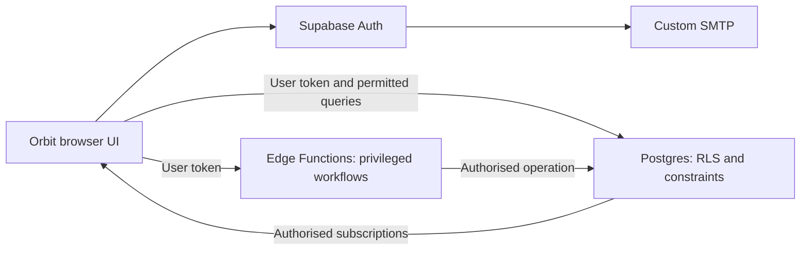

# Orbit v2 — architecture decision record

Decision date: 2026-10-23. Selected planning architecture; resources not provisioned.

## Selected stack

| Layer | Decision | Reason |
| --- | --- | --- |
| Browser | Existing HTML/CSS and modular JavaScript, Sea Glass SVG assets | Reuse working UI; no framework rewrite required for accounts |
| Website delivery | Cloudflare Pages, distinct staging and production origins | Static frontend hosting, previews and configurable headers |
| Identity | Supabase Auth, email/password and confirmed email | Managed authentication and recovery |
| Shared data | Supabase PostgreSQL with RLS and constrained SQL functions | Relational connections, memberships, RSVPs and enforceable permissions |
| Privileged operations | Supabase Edge Functions | Invitation checks, account deletion and moderation workflows |
| Updates | Supabase Realtime in Phase 4+ | Authorised conversation/event updates; never global broadcasts of private data |
| Transactional email | Resend via custom SMTP | Verification/recovery delivery; verify a sender domain before real recipients |
| Delivery and tests | GitHub Actions and versioned migrations | Reproducible checks, separate deploy targets and recorded releases |

Alternatives considered: keep GitHub Pages (retain demo only; its guidance excludes password transactions); Vercel + Next.js (additional framework migration not needed now, Hobby restricted to personal/non-commercial use); a bespoke C++ backend (maintainable later, but significantly more auth/operations work for this pilot). The managed stack reduces implementation scope; it does not remove the need to write and test permissions.

## Trust boundary

The existing WASM core runs on the visitor's machine and cannot enforce trust. v2 server policies become authoritative for identity, profile ownership, invitation eligibility, blocks, connections and message permissions. SQL constraints/functions enforce atomic state changes; Edge Functions verify caller identity and permissions before privileged operations. Default-deny RLS applies to every exposed user-data table, including realtime access. Public views/functions must not bypass those rules.

Retain the C++ core and its 11 tests for the demo and as a source of validation/ranking examples. Pure scoring code may later be reused, but browser filtering is not an access-control mechanism. Do not download an entire real-profile dataset to WASM. Server-filter and paginate eligible candidates (initial page limit 20, hard maximum 50); rank only approved fields. No inference from hidden age/gender fields.

Only the public project URL and publishable client key may be in browser configuration. Privileged keys, SMTP credentials and database passwords stay in managed secrets, never Git, frontend bundles or public workflow logs. Browser sessions use the supported auth client; no separate hand-rolled token store. Enforce CSP/security headers, dependency review, plain-text rendering and no unnecessary third-party scripts to reduce session theft risks. Clear user-scoped caches at sign-out/account switch. Sensitive operations recheck user/session status server-side; never trust stale UI state.

## Conceptual model and access rules

Names below are a design, not executed SQL. All timestamps use UTC; display campus-local dates in Africa/Johannesburg.

| Entity | Important fields / constraints | Access |
| --- | --- | --- |
| auth.users | Provider UUID and login identity | Managed Auth; email not copied into public profiles |
| account_private | user_id PK/FK, eligibility attestation time, policy versions, onboarding/status, deletion request | Owner reads permitted fields; privileged state changes only server-side |
| profiles | user_id unique, display_name, campus/university/degree FKs, year, bio, discoverable | Owner edits allowed fields; eligible same-campus audience or accepted connections reads permitted profile fields; block rules override |
| universities/campuses/degrees/interests | Stable catalogue IDs; campus belongs to university | Readable catalogues; staff-maintained |
| profile_interests / intentions | Unique user+choice pairs; 1–5 interests enforced transactionally | Same profile audience; owner edits |
| invitations | token hash, bound email, expiry, used_at | Server only; rate-limited redemption |
| connections | canonical low/high user IDs unique, requester, pending/accepted/declined, timestamps | Pair participants only; atomic transition functions |
| blocks | blocker+blocked unique, no self-block | Owner manages; server consults both directions without exposing blocker lists |
| bookmarks | owner+target unique | Owner only; target eligibility rechecked on reads |
| conversations / messages | one direct conversation per pair, sender, body, sent_at, last-read cursor | Accepted participants can send; participants can read retained history; blocks/removal stop sends and live subscription; suspended/deleting users denied |
| circles / memberships / posts / replies | campus, owner, member/moderator role, membership unique | Campus-scoped circle discovery; members read/post; authorised moderators act |
| events / rsvps | organiser, campus, optional circle, time, venue text, capacity, user+event unique | Eligible audience; attendance opt-in; capacity enforced in a transaction |
| notifications | recipient, minimal payload, read_at | Recipient only; no message bodies in email/lock-screen notices |
| reports / report_evidence / moderation_actions | reporter, subject, bounded evidence, status, actor, timestamp | Reporter limited status; authorised staff case access with audit |

Private fields must be in separate protected tables; RLS controls rows, not selective column confidentiality by itself. Do not expose a broad profile row then merely hide its email in the UI. Foreign keys, server-side limits and unique constraints are required in addition to RLS. Test concurrent request acceptance, block-vs-send races and event-capacity races. In-flight writes must serialise/recheck relationships so a block cannot be bypassed by an earlier client check.

## Environments, migration and operations

- Keep the current GitHub Pages site as a clearly labelled fictional demo. Real sign-up will be on the new host, not added to the existing Pages URL.
- Use local synthetic test data, a separate staging Supabase project and a production project. Never copy real production data into staging. Auth redirect allowlists bind each environment to its own origins; untrusted preview branches get no production credentials.
- A separate future v2 app directory and workflow leave the existing CMake demo build intact. Maintain migration history under supabase/migrations when Phase 2 starts. Changes are tested against a fresh database and an upgrade fixture before deployment.
- Do not import localStorage demo data, fake profiles, visitor:local or fictional bookmarks into accounts. Reuse only public catalogue IDs and brand assets. Real user IDs come from Auth.
- Deploy additive database changes before dependent UI. Keep a compatible rollback frontend; never blindly reverse destructive database migrations. Test recovery from backups before the invited pilot. Backups of a database are not automatically backups of future file storage.
- Begin with bounded rate limits (configuration targets: 5 new requests/minute and 20/day per user; 30 text messages/minute; 2,000 code points/message). Tune against pilot behaviour; enforce on the server, not just disabled buttons. Auth endpoints also use provider rate limits.
- Proposed pilot recovery targets: up to 24 hours data loss and service restoration within one working day, subject to a demonstrated restore drill. Assign an operator and support contact before inviting students.

## Costs and vendor facts

Checked 2026-10-23 in official documentation. USD amounts exclude tax, exchange rates, domain registration, usage overages and labour. This is a budget proposal, not purchase authorisation or a guarantee.

| Item | Planning basis |
| --- | --- |
| Development | Local/synthetic development plus free tiers; no recurring spend authorised |
| Supabase production | Pro starts at $25/month with one project; additional projects start at $10/month. Free projects can pause after inactivity. Use paid production for an invited pilot if approved |
| Staging | Local development or separate free project initially; if a second paid project is used, plan from $35/month total backend cost |
| Frontend | Cloudflare Pages Free plan within its limits, currently 500 builds/month; Functions have separate Workers quotas |
| Email | Resend Free currently has a 100-email/day cap; verify full plan allowance and sender domain during setup. Batch invitations to leave room for recovery mail; upgrade only after a separate quote/approval |
| Budget envelope | Propose $35–60/month for a small pilot's services, plus domain costs. An internal planning allowance, not a hard provider spending cap; usage alerts and monthly review required |

No provider account, region, sender domain, paid plan or billing cap has been configured. Choose region at provisioning from available regions after latency and cross-border processing review. Do not promise South African data residency without evidence.

## Sources

- [Supabase pricing](https://supabase.com/pricing): quoted plan prices, inactivity and daily-backup terms.
- [Supabase RLS](https://supabase.com/docs/guides/database/postgres/row-level-security): database authorisation design.
- [Supabase custom SMTP](https://supabase.com/docs/guides/auth/auth-smtp): default mail is restricted and unsuitable for real-user production delivery.
- [Supabase Edge Functions](https://supabase.com/docs/guides/functions): managed server operations.
- [Available regions](https://supabase.com/docs/guides/platform/regions): region selection at provisioning.
- [Cloudflare Pages limits](https://developers.cloudflare.com/pages/platform/limits/): free-plan build and asset limits.
- [Resend pricing](https://resend.com/pricing): daily free email cap; recheck at provisioning.
- [GitHub Pages limits](https://docs.github.com/en/pages/getting-started-with-github-pages/github-pages-limits): hosting restrictions for password transactions and commercial SaaS.
- [Vercel Hobby](https://vercel.com/docs/plans/hobby): alternative hosting restrictions.
